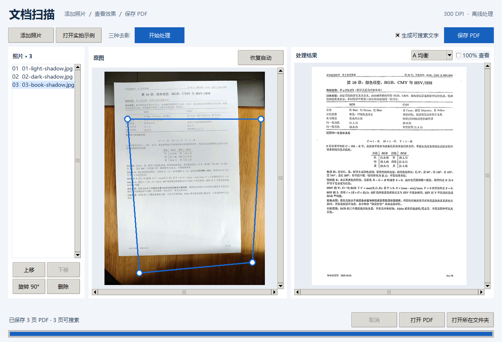

# DocScan · 手机照片转白底 PDF

把手机拍的纸张、书页自动摆正、去阴影，导出 300 DPI 白底 PDF；可选中文可搜索文字层。Windows 桌面版内置 OCR 模型，解压即用，离线运行。



## 下载即用（Windows x64）

1. 打开 [Releases · v0.2.1](https://github.com/Yang-muuu/course-docscan/releases/tag/v0.2.1)，下载 `DocScan-Windows-x64-v0.2.1.zip`（约 325 MB）。
2. 解压到任意文件夹。请先完整解压，再双击里面的 `DocScan.exe`。
3. 首次启动稍慢，之后即可正常使用。

- 支持 Windows 10/11 x64，不需要安装 Python，也不需要联网。
- 若出现「Windows 已保护你的电脑」，点「更多信息」→「仍要运行」。
- 想直接看效果，点「打开实拍示例」，内置 3 张实拍讲义照片。

## 三步完成扫描

### 1. 添加照片

点「添加照片」，选择一张或多张 JPG/JPEG/PNG。左侧列表的顺序就是 PDF 的页序，可用「上移」「下移」「旋转」「删除」调整。

### 2. 确认边界

导入后程序自动识别纸页，并在原图上显示四个圆点。需要微调时拖动圆点；拖错了点「恢复自动」即可撤回。书页照片按主体页处理。

### 3. 选效果并保存

点「开始处理」，每张照片会生成 A、B、C 三种去影结果。在右侧「处理结果」逐张选择，点「保存 PDF」。

勾选「生成可搜索文字」会额外写入不可见中文文字层，之后可在 PDF 里按 Ctrl+F 搜索；这会多花一点处理时间。不勾选则只保存图像。

保存的 PDF 为 300 DPI，一页对应一张照片，使用你为每张照片选定的版本。

## A/B/C 怎么选

| 候选 | 适合场景 | 处理倾向 |
| --- | --- | --- |
| **A 均衡** | 大多数照片，先看这一版 | 正文与白底平衡，整体自然 |
| **B 强去影** | 重阴影、灰底、阴影边缘发灰 | 更积极地压掉阴影和浅底纹 |
| **C 保细节** | 浅色细线、公式、彩色插图 | 保留更多灰阶，避免过度漂白 |

不确定时重点比较字迹是否发虚、阴影边缘是否残留灰带、浅色线条是否还在。

## 从源码运行

需要 Windows x64 与 Python 3.13（3.11–3.13 可用，锁文件对应 3.13）。在项目根目录打开 PowerShell：

```powershell
$env:PYTHONUTF8 = '1'
python -m venv .venv
$py = '.\.venv\Scripts\python.exe'
& $py -m pip install -r requirements.win-py313.lock
& $py -m pip install --no-build-isolation --no-deps -e .
& $py -m docscan prepare-models
& $py -m docscan prepare-models --candidates
& $py -m docscan.desktop
```

`prepare-models` 首次运行会下载并校验 OCR 权重，之后可离线使用。只做图像矫正、不需要 OCR 时，安装 `& $py -m pip install -e .` 即可。

构建便携包（含运行时、模型和示例）：

```powershell
& $py scripts\build_desktop.py --output dist\DocScan
```

产物在 `dist\DocScan`，双击其中的 `DocScan.exe` 运行。模型目录默认是 `.models`，可用 `--models` 指定。

## 命令行（可选）

桌面版适合逐张选图；批量处理、可搜索 PDF 和复现实验用命令行。完整参数见 [命令行用法](docs/cli.md)。

```powershell
# 单张照片或目录 -> 白底 PDF
& $py -m docscan to-pdf --input examples/synthetic/sample.jpg --page-format a4 --output outputs/quick_scan

# 摊开的书 -> 左右分页
& $py -m docscan to-pdf --input '书页照片目录' --layout spread --output outputs/book_pdf

# 一张原图生成 A/B/C 三个候选
& $py -m docscan candidates --input examples/real/01-light-shadow.jpg --output outputs/abc

# 带中文可搜索文字层
& $py -m docscan to-pdf --input '书页照片目录' --pdf-mode searchable --output outputs/book_search
```

## 测试

```powershell
& $py -m pip install -e ".[test]"
& $py -m pytest -m "not ocr_integration"
```

OCR 集成测试需要本机已准备 PaddleOCR 权重：

```powershell
& $py -m pytest -m ocr_integration
```

GitHub 的 [Windows validation](.github/workflows/windows.yml) 会在推送和拉取请求时运行核心回归测试并核对合成 A4 PDF。

## 更多文档

- [实拍去影示例与 A/B/C 说明](examples/real/README.md)
- [命令行完整用法](docs/cli.md)
- [拍摄与数据导入](docs/data.md)
- [OCR 对照实验协议](docs/experiment.md)
- [第三方依赖与模型来源](THIRD_PARTY.md)

## 项目结构

- `src/docscan/`：桌面程序、几何矫正、去影、候选生成、OCR 与 PDF 导出
- `scripts/`：便携包构建与界面验收
- `examples/real/`：内置实拍示例；`examples/synthetic/`：可复现合成样例
- `configs/`、`docs/`：默认参数与数据/实验说明
- `tests/`：几何、书页、OCR 与 PDF 的回归测试

本项目为课程作业；第三方依赖与模型的来源和许可见 [THIRD_PARTY.md](THIRD_PARTY.md)。
